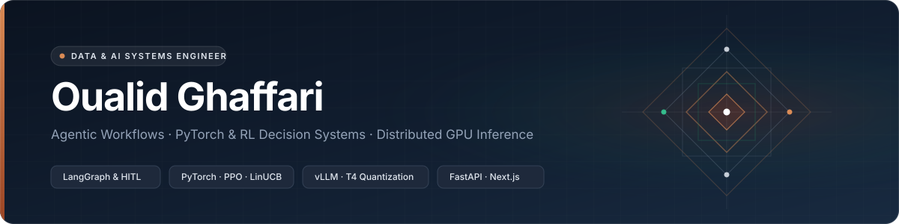

  

   

  
  
  

   
   

  **[Flagship](#flagship-project)** · **[Selected Work](#selected-work)** · **[Engineering Stack](#engineering-stack)** · **[Research](#research-interests)** · **[Education](#education--credentials)**

---

## About

I am a **Data & AI Engineer** (AI Engineering degree, ENIADB) designing production-oriented AI systems at the intersection of **agentic workflows**, **machine learning / reinforcement learning**, and **distributed GPU inference**.

I focus on moving AI beyond notebooks into **deterministic, auditable, and cost-efficient software** — combining structured contracts, human-in-the-loop governance, and measurable optimization against baselines.

- **Core focus:** Multi-agent orchestration (`LangGraph`), trainable routing & decision policies (`PyTorch`, `Gymnasium`, `PPO`), enterprise RAG, and quantized LLM serving (`vLLM` on T4 GPUs).
- **Engineering philosophy:** *Deterministic math over LLM guesses · Evidence-backed outputs · Rigorous multi-seed evaluation.*

---

## Flagship Project

<table>
<tr>
<td width="100%" valign="top">
<h3>00 / <a href="https://github.com/ghaffariOualid/Agentic-Credit-Intelligence-ACI-">Agentic Credit Intelligence (ACI)</a> — <em>Flagship System</em></h3>

<strong>Distributed corporate credit analysis platform with trainable PyTorch/RL model routing &amp; HITL governance</strong>

  End-to-end banking AI workspace featuring a 5-agent <strong>LangGraph</strong> runtime with native <code>interrupt()</code> human-in-the-loop checkpoints, a <strong>100% deterministic financial engine</strong> (DSCR, leverage, debt reconciliation), verifiable document evidence (<code>EvidenceRef</code>), versioned PDF reporting, and an OpenAI-compatible <strong>Inference Gateway</strong> serving quantized <code>Qwen2.5-AWQ</code> models on <strong>vLLM (NVIDIA T4 16GB)</strong>.

  <strong>Key engineering results:</strong> Trainable Decision Engine (<code>PyTorch MLP</code>, <code>LinUCB Bandit</code>, <code>PPO + Action Masking</code>) evaluated in a custom <code>Gymnasium</code> T4 simulator across multiple seeds — achieving <strong>−67% to −77% relative GPU cost</strong> vs. static large-model serving while enforcing non-bypassable compliance checks (26/26 automated tests passing).

<code>LangGraph</code> <code>FastAPI</code> <code>Next.js 15</code> <code>PyTorch</code> <code>Gymnasium</code> <code>PPO</code> <code>vLLM</code> <code>Pydantic</code> <code>ReportLab</code>
</td>
</tr>
</table>

---

## Selected Work

<table>
<tr>
<td width="50%" valign="top">
<h3>01 / <a href="https://github.com/ghaffariOualid/AitherisRAG">Aitheris RAG</a></h3>

<strong>Enterprise document intelligence</strong>

Modular RAG platform with distributed document ingestion, hybrid dense/sparse retrieval, cross-encoder reranking, multi-model routing, and full observability.

<code>FastAPI</code> <code>Celery</code> <code>Qdrant</code> <code>PostgreSQL</code>
</td>
<td width="50%" valign="top">
<h3>02 / <a href="https://github.com/ghaffariOualid/FEderatedMedical">Federated Medical AI</a></h3>

<strong>Privacy-preserving distributed learning</strong>

Decentralized model training and encrypted parameter aggregation for sensitive healthcare datasets using federated learning and CKKS homomorphic encryption.

<code>Federated Learning</code> <code>CKKS</code> <code>Kafka</code> <code>PyTorch</code>
</td>
</tr>
<tr>
<td valign="top">
<h3>03 / <a href="https://github.com/ghaffariOualid/cryptomonnaies">Crypto Streaming Platform</a></h3>

<strong>Real-time data &amp; ML pipelines</strong>

High-throughput streaming ingestion, windowed feature engineering, real-time anomaly detection, data lake persistence, and reproducible experiment tracking.

<code>Kafka</code> <code>Spark</code> <code>HDFS</code> <code>MLflow</code>
</td>
<td valign="top">
<h3>04 / <a href="https://github.com/ghaffariOualid/RAGDotNet">RAG .NET</a></h3>

<strong>Full-stack knowledge assistant</strong>

Source-aware semantic indexing and grounded conversational retrieval built on an ASP.NET Core backend, pgvector storage, and an Angular workspace.

<code>ASP.NET Core</code> <code>Angular</code> <code>pgvector</code>
</td>
</tr>
<tr>
<td valign="top">
<h3>05 / <a href="https://github.com/ghaffariOualid/maghrib-id-recognition">Maghrib ID Recognition</a></h3>

<strong>On-device computer vision</strong>

Offline mobile OCR pipeline for Moroccan identity documents with structured field parsing, validation rules, and local geographic lookup.

<code>Flutter</code> <code>ML Kit</code> <code>OCR</code>
</td>
<td valign="top">
<h3>06 / <a href="https://github.com/ghaffariOualid/exam_corrector-ENIAD">GradeGenius</a></h3>

<strong>AI-assisted document assessment</strong>

Automated exam digitization, OCR extraction, rubric-guided LLM evaluation, and structured personalized student feedback.

<code>Next.js</code> <code>FastAPI</code> <code>NLP</code> <code>OCR</code>
</td>
</tr>
</table>

---

## Engineering Stack

| Layer | Technologies & Methods |
| :--- | :--- |
| **Agentic & LLM Systems** | LangGraph · LangChain · MCP · Dify · Hybrid RAG · Tool Orchestration · Human-in-the-Loop (HITL) · Pydantic Contracts |
| **ML & Decision Intelligence** | Python · PyTorch · Gymnasium · PPO · Contextual Bandits (LinUCB) · scikit-learn · XGBoost · LightGBM · Fine-tuning |
| **Inference & AI Infra** | vLLM (AWQ / FP16) · OpenAI-Compatible Gateways · Docker · Linux · CI/CD · MLflow · Prometheus · Grafana |
| **Data & Retrieval** | Kafka · Apache Spark · PostgreSQL · pgvector · Qdrant · Redis · HDFS |
| **Backend & Applications** | FastAPI · Next.js · TypeScript · ASP.NET Core · Angular · Celery · SSE Streaming |

---

## Research Interests

- **Agentic Systems & Reliability:** deterministic guardrails, structured tool contracts, checkpointed HITL workflows, and systematic agent evaluation.
- **Decision Intelligence & RL:** contextual bandits, policy-gradient methods (PPO with action masking), and multi-objective cost/latency/quality optimization.
- **Efficient Model Serving:** quantization (AWQ/GPTQ), KV-cache management, and resource-aware LLM routing on constrained GPUs.

---

## Education & Credentials

| Period | Degree / Credential | Institution |
| :--- | :--- | :--- |
| **2023 – 2026** | **Engineering Degree in Artificial Intelligence** | ENIADB |
| **2021 – 2023** | **DEUST — Mathematics, Computer Science & Physics** | FST Errachidia |
| **Certifications** | Oracle OCI Generative AI Professional · Supervised Machine Learning · Apache Hadoop | Oracle / Coursera |

---

## GitHub Activity

  
  

---

  <strong>Build thoughtfully. Evaluate rigorously. Deploy reliably.</strong> 
  Open to AI Engineering, ML Systems, and Agentic Architecture collaborations.

